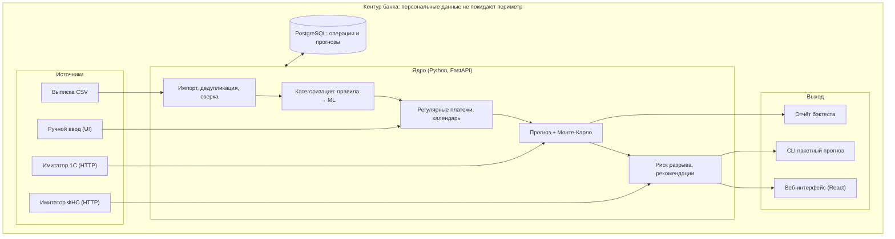
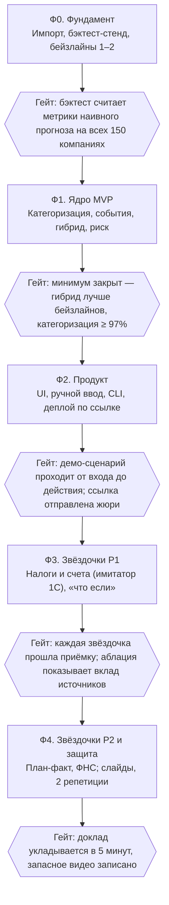

# ТЗ: сервис прогноза денежных потоков для МСП

24.10.2026 · @danyblackky

## 1. Назначение и цели

Сервис по выписке расчётного счёта строит прогноз остатка по дням на 30+ дней вперёд, находит будущие кассовые разрывы (дата, сумма, вероятность, причина) и предлагает действие. Работает как модуль банковского приложения «Центр-инвест»: ноль настройки, прогноз готов сразу после загрузки выписки.

**Цели прототипа (к защите):**

1. Полностью закрыть 4 минимальных требования кейса: прототип, модуль категоризации, модель прогноза с проверкой качества, интерфейс с графиком остатка и списком предупреждений. Без этого звёздочки не засчитываются.
2. Показать измеримое качество прогноза и детектора разрывов на бэктесте, устойчивое к скрытому датасету жюри.
3. Реализовать 2–3 задачи со звёздочкой полностью рабочими (недоделанная фича не засчитывается), остальные — в планах развития.
4. Публичная ссылка на прототип до защиты; демо 3–5 минут на реалистичном сценарии.

**Вне рамок:** реальные подключения к API банка, 1С и ФНС (заменяются сервисами-имитаторами), мобильное приложение, мультивалютность, несколько счетов в разных банках.

**Связь с критериями жюри:**

| Критерий жюри | Чем закрываем | Метрика успеха |
| --- | --- | --- |
| Качество прогноза | Гибрид «календарь событий + статистика выручки», сравнение 4 подходов, rolling-origin бэктест | MASE < 1 против наивного прогноза на горизонте 30 дней; выигрыш над лучшим бейзлайном |
| Выявление разрывов | Вероятность разрыва Монте-Карло, разметка явных и скрытых разрывов | Recall ≥ 0,7 при precision ≥ 0,5; медиана заблаговременности ≥ 10 раб. дней |
| Доп. источники | Налоговый календарь, реестр счетов, ручной ввод, имитаторы 1С/ФНС | Снижение ошибки прогноза от каждого источника в абляции |
| Техкачество | Модульная архитектура, тесты, обработка пропусков и дублей, инкрементальное обновление | Покрытие ядра тестами ≥ 70%; прогон всех 150 компаний без ошибок |
| Презентация | Демо на 3 заранее отобранных компаниях, 1 слайд на каждый блок | Укладываемся в 5 минут |

Целевые значения метрик — ориентиры команды; пересматриваются после первого бэктеста.

## 2. Пользователи и сценарии

Основной пользователь — владелец малого бизнеса (ООО или ИП) без финансиста, который следит за деньгами по банковской выписке и в голове.

В центре предметной области — один предприниматель и его компания (ментор подтвердил, что это допустимое решение). Все 150 компаний датасета используем только внутри: для отраслевых профилей, обучения категоризатора и бэктеста. Пользователь видит только свою компанию (или несколько, если их у него больше одной).

| Роль | Кто это | Что делает в сервисе | Доступ |
| --- | --- | --- | --- |
| Предприниматель | Владелец / директор МСП | Смотрит прогноз и предупреждения, добавляет события, запускает сценарии | Только свои компании |
| Бухгалтер (в т.ч. аутсорс) | Ведёт учёт в 1С | Загружает счета и договоры, правит категории | Компании, к которым дан доступ |
| Клиентский менеджер банка | Сопровождает портфель МСП | Видит клиентов с риском разрыва, предлагает овердрафт / кредит | Портфель, только агрегаты (звёздочка, опционально) |
| Жюри / проверяющий | Оценивает прототип | Загружает свой датасет, получает прогнозы пакетом | Демо-аккаунт + CLI / API |

**Ключевые сценарии (user stories):**

1. **US-1. Первый вход.** Как предприниматель, я хочу сразу увидеть прогноз остатка на 30 дней без настройки, чтобы понять, хватит ли денег.
2. **US-2. Предупреждение о разрыве.** Я хочу узнать дату, сумму и вероятность нехватки и какие платежи её вызывают: «Через 12 дней не хватит 340 тыс. ₽: зарплата + ЕНП».
3. **US-3. Действие.** Я хочу видеть 2–3 конкретных варианта: перенести платёж, напомнить клиенту о счёте, подключить овердрафт.
4. **US-4. Понятность.** Я хочу видеть, откуда взялось каждое будущее событие (история, налоговый календарь, счёт, ручной ввод), чтобы доверять прогнозу.
5. **US-5. Ручное событие.** Я хочу добавить «клиент обещал 300 000 ₽ 20-го» и сразу увидеть новый прогноз.
6. **US-6. Что если.** Я хочу проверить «крупный клиент заплатит на 3 недели позже» и увидеть базовый и негативный прогноз на одном графике.
7. **US-7. План-факт.** Я хочу получить сигнал, если ожидаемый платёж не пришёл, и пересчитанный прогноз.
8. **US-8. Пакетная проверка.** Как жюри, я хочу подать папку выписок в формате кейса и получить CSV с прогнозами и разрывами по каждой компании.

## 3. Входные данные

Основной источник — выписка по одному расчётному счёту. Датасет кейса: 150 компаний, 15 отраслей, 222 420 операций за 01.10.2024–30.09.2026. Жюри проверяет на отдельном скрытом датасете, поэтому формат читаем строго, а логику не подгоняем под конкретные компании.

**Формат выписки (CSV, UTF-8 с BOM, разделитель `;`):**

| Поле | Тип | Правило чтения |
| --- | --- | --- |
| company\_id | строка | Ключ компании |
| operation\_id | строка | Уникален внутри выписки; дубли ищем по остальным полям |
| operation\_date | дата `ГГГГ-ММ-ДД` | Только рабочие дни по производственному календарю РФ |
| amount | число, точка | Всегда > 0; знак задаёт direction |
| direction | `Поступление` / `Списание` | Иные значения — ошибка валидации строки |
| counterparty\_inn | строка | **Только строка** (ведущие нули); 10 знаков — организация, 12 — ИП/физлицо; пуст в 5% |
| counterparty\_name | строка | Ключ контрагента = ИНН, при отсутствии — наименование |
| payment\_purpose | свободный текст | Пуст в 0,3%; содержит номера и даты счетов/УПД |
| balance\_eod | число | Остаток на конец дня, одинаков для всех операций дня; может быть < 0 (овердрафт) |

**Факты из EDA, которые задают требования:**

- Остаток сходится с потоками в 99,9% дней. Нарушения: 21 строка-дубль (в остатке не учтена) и 35 скачков остатка после пропусков выгрузки (до 6,5 млн ₽).
- 169 пропусков ≥ 5 рабочих дней у 46 компаний; 12 компаний с историей < 6 месяцев, минимум 1,6 месяца.
- Назначения шаблонные с вариациями («Единый налоговый платеж» / «ЕНП» / «платёж»); правила покрывают 99,99% операций.
- Явный разрыв (остаток < 0) был у 16 компаний; скрытый (владелец докладывает деньги при нулевом остатке) — у 78.
- Эквайринг зачисляется T+1, по понедельникам в 3,1 раза больше; ЕНП — 28-го числа; зарплата — аванс + расчёт.
- В B2B-оплатах есть номер и дата счёта; задержка оплаты — от 13 (IT) до 91 (строительство) дней по медиане.
- Налоговый режим в данных не указан (УСН 6% / 15%, ОСНО, ЕСХН) — определяем по истории платежей или спрашиваем у пользователя.

**Внешние источники (все события из них помечаются источником):**

| Источник | Что даёт прогнозу | Реализация в прототипе |
| --- | --- | --- |
| Налоговый календарь + производственный календарь РФ | Даты ЕНП, авансов УСН, НДС; перенос на рабочий день | Справочник в коде |
| 1С (счета, договоры) | Ожидаемые поступления и оплаты с датами и суммами | Сервис-имитатор OData + импорт client-bank |
| ФНС / открытые реестры | Статус контрагента (ликвидация, долги) → риск неоплаты | Сервис-имитатор по ИНН |
| Банк (внутренние) | Графики кредитов, зарплатный проект, неисполненные платёжки | Сервис-имитатор |
| Ручной ввод | События, которых нет нигде («куплю оборудование в декабре») | Форма в UI + API |

## 4. Функциональные требования MVP (обязательные)

MVP = выписка + ручной ввод документов предпринимателем → категории → регулярные события → прогноз → разрывы → экран. По разъяснению ментора (24.10), учёт счетов и налогов, о которых предприниматель сообщает вручную, — обязателен; автоматическая подгрузка — звёздочка.

### 4.1. Импорт и предобработка

- **FR-1.1** Загрузка выписки CSV в формате кейса (один файл, папка или общий файл со многими company\_id). Валидация схемы, отчёт об ошибочных строках без падения.
- **FR-1.2** Удаление дублей: одинаковые все поля, кроме operation\_id, и сверка с остатком подтверждает, что строка лишняя.
- **FR-1.3** Сверка остатка по дням; день с несходкой после пропуска ≥ 3 раб. дней помечается «дыра в данных» и исключается из обучения модели потоков.
- **FR-1.4** Дневной ряд остатка на календаре рабочих дней РФ (с переносами и рабочими субботами); целевой ряд = `balance_eod`.
- *Приёмка:* все 150 выписок загружаются без ошибок; найдены 20 из 20 дублей, не учтённых в остатке; ИНН сохраняет ведущие нули.

### 4.2. Категоризация

- **FR-2.1** Каждая операция получает категорию из справочника (\~25 категорий: эквайринг, СБП, наличные, оплаты клиентов, маркетплейсы, закупки, зарплата, ЕНП, аренда, кредиты, лизинг, деньги владельца, переводы между своими счетами и др.) и признаки: операционная / финансовая, обязательный платёж да/нет.
- **FR-2.2** Три слоя: правила по назначению → история того же контрагента → ML-классификатор (TF-IDF + логрег) для неизвестных формулировок. У каждой операции хранится источник категории и уверенность.
- **FR-2.3** Пользователь может исправить категорию; правка применяется ко всем операциям этого контрагента с тем же шаблоном.
- *Приёмка:* точность ≥ 97% и macro-F1 ≥ 0,9 на ручной разметке 500 случайных операций; «Прочее» ≤ 1% операций.

### 4.3. Регулярные платежи и ручной ввод документов

- **FR-3.1** Детектор регулярности по связке «контрагент × категория»: период (неделя, 2 недели, месяц, квартал), типичный день, ожидаемая сумма и её разброс. Серия регулярна, если ≥ 3 платежа и разброс интервала (CV) ≤ 0,35.
- **FR-3.2** Календарные правила: ЕНП 28-го с переносом на рабочий день, зарплата двумя волнами по истории компании, эквайринг T+1.
- **FR-3.3** Ручной ввод будущих событий: выставленный счёт, полученный счёт, налоговая квитанция, разовое событие. Поля: тип, направление, сумма, дата или срок оплаты, контрагент, уверенность («точно» / «скорее всего» / «не уверен»), комментарий.
- **FR-3.4** Для выставленного счёта дата поступления = дата счёта + задержка оплаты этого клиента по истории (или по отрасли, если клиент новый). Ручное событие не дублирует уже спрогнозированный регулярный платёж (сведение по контрагенту, сумме ±20% и дате ±5 дней).
- *Приёмка:* для демо-компаний все арендные, кредитные, лизинговые платежи и ЕНП найдены как регулярные; ручное событие меняет прогноз за < 2 с.

### 4.4. Прогноз остатка

- **FR-4.1** Прогноз на 30 рабочих дней (настраиваемо до 90) от последней даты выписки: базовая траектория + интервал P10–P90.
- **FR-4.2** Деньги владельца и переводы между своими счетами в прогноз не закладываются (они реакция на разрыв, а не план).
- **FR-4.3** Каждая точка прогноза раскладывается на события с источником: «история», «календарь», «ручной ввод», «интеграция», «сценарий».
- **FR-4.4** История < 3 месяцев → отраслевые профили (сезонность, день недели) + пометка «прогноз приблизительный»; < 20 рабочих дней → только известные события, без статистики.
- *Приёмка:* метрики из раздела 6 на бэктесте; прогноз по одной компании ≤ 3 с.

### 4.5. Оценка риска разрыва

- **FR-5.1** Разрыв = день, когда прогнозный остаток ниже порога (по умолчанию 0 ₽; пользователь может задать неснижаемый остаток).
- **FR-5.2** Для каждого эпизода: дата начала, длительность, максимальная нехватка (₽), вероятность (доля Монте-Карло траекторий ниже порога, ≥ 1 000 симуляций), 3 главных платежа-причины.
- **FR-5.3** Уровни риска словами: «почти наверняка» (≥ 80%), «вероятно» (50–80%), «возможно» (20–50%).
- **FR-5.4** Рекомендации по правилам: перенести необязательный платёж позже разрыва, напомнить клиенту о просроченном счёте, овердрафт на сумму нехватки + 10%.
- *Приёмка:* на бэктесте recall / precision / заблаговременность не ниже целей из раздела 1.

### 4.6. Интерфейс

- **FR-6.1** Главный экран: одна фраза-итог («Денег хватит до 15 ноября»), график остатка (факт 90 дней + прогноз с интервалом, зона ниже порога выделена), список предупреждений.
- **FR-6.2** Карточка предупреждения: когда, сколько не хватит, насколько вероятно, почему (платежи-причины), что сделать (кнопки действий).
- **FR-6.3** Календарь будущих событий с источником каждого; список операций с категориями и правкой; форма ручного ввода.
- **FR-6.4** Язык без терминов: «денег не хватит», а не «кассовый разрыв P(gap)»; адаптивная вёрстка до 375 px.
- *Приёмка:* человек без финансового образования за 30 секунд отвечает: когда не хватит денег, сколько и почему (тест на 3 респондентах).

## 5. Задачи со звёздочкой

Берём три звёздочки и доводим их до состояния «рабочее и готовое к использованию»: налоги с автоподгрузкой счетов, «что если», план-факт. Интеграции делаем в объёме, нужном для первой звёздочки. Граница по разъяснению ментора: ручной ввод документов — MVP (FR-3.3), автоматическая подгрузка и будущие события, о которых история «не знает» (новый договор, новый налог), — звёздочка.

| Звёздочка | Приоритет | Решение |
| --- | --- | --- |
| 1. Договоры, счета, налоги | P1 | Делаем полностью |
| 3. Сценарии «что если» | P1 | Делаем полностью |
| 2. План-факт и автообновление | P2 | Делаем, если MVP и P1 готовы |
| 4. Интеграции | P2 | Имитаторы 1С и ФНС в рамках звёздочки 1; банк, кассы, маркетплейсы — в планах |

### 5.1. Договоры, счета и налоги (автоматически)

- **FR-7.1** Налоговый календарь: ЕНП до 28-го, авансы УСН по кварталам, НДС тремя равными долями в квартале после отчётного, страховые взносы. Режим налогообложения — определяем по истории платежей (наличие НДС в назначениях, квартальный ритм ЕНП) или задаёт пользователь.
- **FR-7.2** Сумма будущего налога рассчитывается от прогнозной выручки и ставки режима, а не копирует прошлый платёж.
- **FR-7.3** Автоподгрузка выставленных и полученных счетов и договоров с графиком платежей, отсрочкой и предоплатой из сервиса-имитатора 1С (отдельный HTTP-сервис, не файловая заглушка).
- **FR-7.4** Сведение: оплаченный счёт закрывается по номеру из назначения платежа (частичная оплата уменьшает остаток долга).
- *Приёмка:* абляция на бэктесте показывает снижение ошибки прогноза и рост recall разрывов от налогового календаря и от реестра счетов (реестр для бэктеста восстанавливаем из назначений: номер + дата счёта).

### 5.2. Сценарии «что если»

- **FR-8.1** Сценарии: клиент платит на N недель позже (2–4, выбор клиента из списка крупнейших); выручка −X% (10–30%); внеплановый расход на дату; рост постоянных расходов (аренда, закупки) на Y%. Сценарии комбинируются.
- **FR-8.2** Базовая и негативная траектории на одном графике; разница: новая дата и сумма разрыва, вероятность «было → стало».
- **FR-8.3** Пересчёт сценария ≤ 1 с (без переобучения модели — трансформация списка событий).
- *Приёмка:* все 4 сценария из кейса работают на демо-компаниях; сценарий с нулевым эффектом даёт траекторию, равную базовой (тест).

### 5.3. План-факт и автообновление

- **FR-9.1** При загрузке новых операций ожидаемые события сопоставляются с фактом (контрагент, сумма ±20%, дата ±5 дней): пришло / пришло частично / не пришло.
- **FR-9.2** Не пришедший в срок платёж → предупреждение + перенос события на новую ожидаемую дату + пересчёт прогноза и риска.
- **FR-9.3** Инкрементальное обновление: новые операции категоризируются и добавляются к статистикам без пересчёта всей истории; полное переобучение — по расписанию.
- **FR-9.4** График план-факт по неделям, отклонения > 20% выделены.
- *Приёмка:* демо «подали ещё одну неделю выписки → предупреждение о не пришедшем платеже и новый прогноз»; инкремент даёт тот же результат, что полный пересчёт (тест).

### 5.4. Интеграции

- **FR-10.1** Сервисы-имитаторы 1С и ФНС — отдельные HTTP-сервисы с поведением настоящих API: авторизация по токену, пагинация, задержки, ошибки 429/503. Форматы близки к реальным (OData 1С, выгрузка client-bank `1CClientBankExchange`, ответ реестра по ИНН).
- **FR-10.2** Клиент интеграции: повторы с экспоненциальной задержкой, идемпотентный импорт (повторная синхронизация не создаёт дублей), статус последней синхронизации в UI.
- **FR-10.3** Контрагент в ликвидации или с налоговым долгом → ожидаемое поступление получает пониженную вероятность и пометку в UI.
- *Приёмка:* при недоступности имитатора прогноз строится по выписке с пометкой «данные 1С устарели»; повторный импорт даёт 0 новых записей.

## 6. Модель прогноза и проверка качества

Прогноз = остаток сегодня + сумма будущих потоков из трёх слоёв. Выбираем гибрид, потому что 1% крупнейших операций даёт 32% оборота: их нужно ставить поштучно, а розничный поток — статистикой.

| Слой | Что прогнозирует | Метод |
| --- | --- | --- |
| A. Известные события | Аренда, кредиты, лизинг, подписки, ЕНП, зарплата, ручной ввод, счета | Детектор регулярности + календарь; сумма = медиана последних 3 платежей |
| B. Розничная выручка | Эквайринг, СБП, наличные, маркетплейсы | Дневная модель: уровень × день недели × сезон (отраслевой профиль при короткой истории), сдвиг T+1 |
| C. Нерегулярный остаток | B2B-поступления без счёта, закупки, прочее | Средний недельный поток за 90 дней с робастной очисткой выбросов; разовые крупные операции исключаются |

**Неопределённость.** Монте-Карло (≥ 1 000 траекторий): бутстреп дневных остатков слоёв B и C, задержки по счетам — из эмпирического распределения клиента или отрасли. Из траекторий берём P10/P50/P90 и вероятность разрыва.

**Сравниваемые подходы (доп. требование кейса):**

1. Наивный: остаток не меняется.
2. Средний дневной чистый поток за 90 дней.
3. Гибрид A + B + C (основной).
4. Градиентный бустинг (LightGBM) по дневному потоку по категориям, обученный на всех компаниях сразу (признаки: день недели/месяца, отрасль, лаги, известные события).

**Протокол проверки:**

- **Rolling-origin бэктест:** точки отсечки каждые 2 недели за последние 6 месяцев (\~12 отсечек), горизонт 30 рабочих дней. Модель видит только данные до отсечки.
- **Отложенные компании:** 20% компаний (стратификация по отрасли) не участвуют в подборе правил и гиперпараметров — имитация скрытого контрольного датасета жюри.
- **Финальный hold-out:** июль–сентябрь 2026, 45 компаний с разрывами; один раз в конце.
- **Маски:** дни после «дыры в данных» исключаются из оценки.

**Как будет проверять жюри (по словам ментора, 24.10):** сначала — поведение на плановых данных контрольного датасета, затем ввод нового события (например, новой выплаты) и реакция решения. Отсюда два требования: (1) прогноз строится в предположении, что непредсказуемых событий нет, а их влияние отражено в ширине интервала P10–P90; (2) любое новое событие (ручной ввод, новая операция в выписке, новый счёт) пересчитывает прогноз и риск за ≤ 1 с, и эффект объяснён в UI («разрыв сдвинулся с 12.11 на 18.11 из-за события X»). Этот сценарий покрываем интеграционным тестом и репетируем до защиты.

**Метрики:**

| Что мерим | Метрика | Зачем |
| --- | --- | --- |
| Точность остатка | MAE на горизонтах 5 / 10 / 20 / 30 дней, делённая на средний дневной оборот компании | Сопоставимо для компаний разного масштаба |
| Выигрыш над бейзлайном | MASE относительно подхода 1 | < 1 = лучше наивного |
| Калибровка | Покрытие интервала P10–P90 (цель \~80%), pinball loss | Честная вероятность разрыва |
| Поиск разрывов | Recall, precision, медиана заблаговременности (дни), ошибка суммы и даты разрыва | Критерий жюри № 2 |
| Вероятность разрыва | Brier score, график калибровки | «70%» должно сбываться в \~70% случаев |
| Вклад источников | Абляция: без календаря / без счетов / без ручного ввода | Критерий жюри № 3 |

**Разметка разрыва для оценки.** Фактический разрыв = день с `balance_eod` < 0 **или** день, когда остаток без поступивших денег владельца был бы < 0 (скрытый разрыв). Эпизод считается найденным, если предупреждение с вероятностью ≥ 50% было выдано до его начала и дата отличается не более чем на 5 рабочих дней.

**Артефакты:** `backtest_report.html` (таблица метрик по подходам и отраслям, графики ошибки от горизонта) — основа слайда «подход и проверка качества».

## 7. Архитектура, API и модель данных

Монолитное ядро на Python с чёткими модулями + два отдельных сервиса-имитатора; всё поднимается одной командой `docker compose up`. Одно ядро обслуживает и UI, и пакетный CLI для жюри, и бэктест — так проверяемый код и демо совпадают.

*Схема: архитектура прототипа — 4 источника, 5 шагов ядра, 3 выхода.*

Источники входят в ядро на своём шаге: выписка — в импорт, ручной ввод — в события, счета из 1С — в прогноз, статус контрагента из ФНС — в оценку риска.

**Стек (предложение, утверждает команда):** Python 3.11, pandas, scikit-learn, LightGBM, FastAPI, PostgreSQL (SQLite для локального запуска), React + Recharts, Docker Compose. Аргумент: один язык для аналитики и бэкенда, зрелые библиотеки, быстрый старт.

**Модули ядра:** `ingest` (чтение, валидация, дубли, дыры) · `categorize` (правила, история контрагента, ML) · `events` (регулярность, налоговый и производственный календари, счета) · `forecast` (слои A/B/C, Монте-Карло, сценарии) · `risk` (эпизоды, причины, рекомендации) · `integrations` (клиенты 1С/ФНС) · `backtest` (оценка качества). Модули не знают про HTTP и тестируются отдельно.

**API (REST, JSON):**

| Метод | Путь | Назначение |
| --- | --- | --- |
| POST | `/auth/login` | Вход, выдача JWT |
| POST | `/companies/{id}/statements` | Загрузка выписки (полной или дозагрузка), отчёт о качестве |
| GET | `/companies/{id}/operations` | Операции с категориями, фильтры |
| PATCH | `/operations/{id}/category` | Правка категории |
| GET | `/companies/{id}/forecast?horizon=30` | Траектория P10/P50/P90 + события с источниками |
| GET | `/companies/{id}/alerts` | Эпизоды разрыва: дата, сумма, вероятность, причины, действия |
| POST / DELETE | `/companies/{id}/events` | Ручное событие (счёт, квитанция, разовый платёж) |
| POST | `/companies/{id}/scenarios` | Расчёт «что если»: база vs сценарий |
| POST | `/companies/{id}/sync` | Синхронизация с имитаторами 1С / ФНС |
| GET | `/companies/{id}/plan-fact` | План-факт по неделям |

CLI для проверки: `cashflow predict --input statements/ --horizon 30 --out results/` → `forecast.csv` (company\_id, date, p10, p50, p90) и `alerts.csv` (company\_id, start\_date, max\_shortfall, probability, causes).

**Модель данных (основные сущности):**

| Сущность | Ключевые поля |
| --- | --- |
| company | id, форма (ООО/ИП), отрасль, налоговый режим, порог неснижаемого остатка, owner\_user\_id |
| operation | id, company\_id, date, amount, direction, counterparty\_key (хеш), purpose\_masked, balance\_eod, category, category\_source, confidence, flags (дубль, дыра, разовая) |
| recurring\_series | id, company\_id, counterparty\_key, category, period, typical\_day, expected\_amount, amount\_cv |
| planned\_event | id, company\_id, date, amount, direction, kind (регулярный, налог, счёт, ручной, сценарий), source, confidence, status (ожидается / пришло / не пришло) |
| forecast\_run | id, company\_id, as\_of\_date, horizon, model\_version, created\_at |
| forecast\_point | run\_id, date, p10, p50, p90 |
| alert | run\_id, start\_date, end\_date, max\_shortfall, probability, causes\[\], actions\[\] |

## 8. Нефункциональные требования

### 8.1. Безопасность и 152-ФЗ

Принцип: сервис — модуль банка, данные не покидают контур. В боевом режиме в выписках будут персональные данные (ИП, физлица-контрагенты, ФИО в назначениях) и банковская тайна.

- **NFR-S1 Аутентификация.** В прототипе — вход по логину и паролю (хеш Argon2/bcrypt) + JWT с коротким сроком жизни; в боевом — банковская авторизация (OIDC). Демо-аккаунт для жюри.
- **NFR-S2 Разграничение доступа.** Пользователь видит только свои компании; проверка владения на каждом запросе по company\_id (защита от IDOR).
- **NFR-S3 Чистые логи.** Не логируем ИНН, наименования контрагентов, ФИО, текст назначения, суммы с привязкой к контрагенту, токены. Логируем идентификаторы, коды событий, длительность. Фильтр-маскировщик в логгере + тест, который падает, если ИНН попал в лог.
- **NFR-S4 Минимизация.** Модели работают на дате, сумме, направлении, категории и хеше контрагента; ФИО в назначении маскируются до записи в хранилище признаков.
- **NFR-S5 Без зарубежных LLM на сырых данных.** Если LLM используется (текст предупреждений), в него уходят только обезличенные агрегаты, либо модель развёрнута в контуре (трансграничная передача требует уведомления РКН). По умолчанию — шаблонные тексты без LLM.
- **NFR-S6 Локализация.** Хостинг и база — на территории РФ (ч. 5 ст. 18 152-ФЗ).
- **NFR-S7 Секреты** только в переменных окружения, не в репозитории; HTTPS; ограничение частоты запросов на вход и загрузку файлов; лимит размера файла 50 МБ.
- **NFR-S8 Согласие.** Для ручного ввода данных о физлицах — отдельный документ согласия (требование с 01.09.2025); в прототипе — экран-заглушка и слайд.

### 8.2. Производительность

| Операция | Цель |
| --- | --- |
| Импорт + предобработка одной выписки (до 3 500 операций) | ≤ 2 с |
| Прогноз + Монте-Карло по одной компании | ≤ 3 с |
| Пересчёт после ручного события или сценария | ≤ 1 с |
| Пакетный прогон 150 компаний (CLI) | ≤ 5 мин |
| Открытие главного экрана (готовый прогноз) | ≤ 1,5 с |

### 8.3. Надёжность и граничные случаи

Сервис не падает на неидеальных данных, а деградирует и честно об этом сообщает.

| Случай | Поведение |
| --- | --- |
| История < 20 рабочих дней | Только известные события + отраслевые профили, бейдж «мало данных» |
| Пропуск в выписке, скачок остатка | Окно маскируется, прогноз стартует от последнего `balance_eod` |
| Дубли строк | Удаляются по сверке с остатком |
| Пустые назначение и ИНН | Категория по истории контрагента / вероятность ML / «Не определено» |
| Новая формулировка назначения | ML-слой; при низкой уверенности — «Прочее», не ошибка |
| Отрицательный остаток сегодня | Разрыв уже идёт: предупреждение «сейчас» + прогноз выхода из минуса |
| Разовая крупная операция (> 20× медианы) | Исключается из обучения статистического слоя |
| Временное закрытие, уход ключевого клиента | Детектор смены режима: уровень выручки переоценивается по последним 20 дням |
| Компания закрыла счёт | Прогноз не строится, понятное сообщение |
| Недоступна интеграция | Прогноз из кэша + пометка о дате последней синхронизации |

## 9. Тестирование и критерии приёмки

Тестируем то, где ошибка дороже всего: сверку остатка, календарь, категории, сборку прогноза и детектор разрывов. Стек тестов — pytest, запуск в CI на каждый push.

| Уровень | Что проверяем | Примеры |
| --- | --- | --- |
| Unit | Чистая логика | ИНН читается строкой; «ЕНП» / «Единый налоговый платёж» → одна категория; 28-е в выходной → ближайший рабочий день; детектор периодичности на синтетическом ряде |
| Свойства (property-based) | Инварианты | Сумма потоков + вчерашний остаток = сегодняшний в прогнозе; сценарий с нулевым эффектом = база; P10 ≤ P50 ≤ P90; инкремент = полный пересчёт |
| Интеграционные | Цепочка целиком | Выписка → прогноз → предупреждение на 3 эталонных компаниях; импорт из имитатора 1С с ошибками 429/503 и повторной синхронизацией |
| Граничные случаи | Таблица 8.3 | Пустой файл, 1 операция, только списания, отрицательный остаток, пропуск 30 дней, битая кодировка |
| Безопасность | NFR-S1–S3 | Чужой company\_id → 403; запрос без токена → 401; в логах прогона нет ИНН и назначений |
| Качество модели | Регрессия метрик | Бэктест на фиксированном подмножестве: метрики не хуже предыдущего коммита |
| UI (дымовой) | Главные сценарии | Playwright: вход → график → ручное событие → сценарий |

**Определение готовности (приёмка прототипа):**

- [ ] Все 150 выписок прогоняются через CLI без ошибок и дают CSV прогнозов и разрывов (US-8)
- [ ] Метрики качества из раздела 1 достигнуты на отложенных компаниях; отчёт бэктеста сгенерирован
- [ ] Модуль категоризации: точность ≥ 97% на ручной разметке 500 операций
- [ ] UI: график остатка с интервалом, список предупреждений, источник каждого события, ручной ввод
- [ ] Каждая заявленная звёздочка проходит свои критерии приёмки из раздела 5; недоделанная — убирается из демо в «планы»
- [ ] Тесты зелёные, покрытие ядра (пакеты ingest, categorize, forecast, risk) ≥ 70%
- [ ] Прототип доступен по ссылке, демо-аккаунт работает, README с запуском одной командой (`docker compose up`)
- [ ] В логах нет чувствительных данных (автотест)

## 10. План работ, роли и демо

Порядок жёсткий: пока не закрыт минимум, звёздочки не начинаем — без него они не засчитываются. Даты фаз привяжем, когда организаторы назовут срок сдачи.

*Схема: план работ — 5 фаз, гейт после каждой.*

Фазы 2 и 3 можно вести параллельно разными людьми, но гейт фазы 1 — общий для всех.

**Роли (фамилии — после фиксации состава):**

| Роль | Отвечает за | Разделы ТЗ |
| --- | --- | --- |
| Data Scientist / аналитик | Категоризация, прогноз, бэктест, метрики | 4.2–4.5, 6 |
| Backend-разработчик | API, хранилище, CLI, имитаторы 1С/ФНС, безопасность | 4.1, 5.4, 7, 8 |
| Frontend-разработчик | Экраны, графики, формы, сценарии в UI | 4.6, 5.2, 5.3 |
| Продакт / докладчик | ТЗ, демо-сценарий, слайды, TOE и 152-ФЗ, вопросы менторам | 1, 2, 10, 11 |

**Сценарий демо (5 минут):**

1. 0:00–0:40 — проблема и решение: владелец без финансиста, сервис внутри банка без настройки (слайд TOE).
2. 0:40–2:20 — живое демо на компании с разрывом (кандидаты из EDA: C009, C082): график → предупреждение «когда, сколько, почему» → ручное событие «клиент заплатит 300 000 ₽» → разрыв исчез → сценарий «клиент заплатит на 3 недели позже» (B2B с крупным клиентом: C066, C117).
3. 2:20–3:00 — источники данных: выписка, ручной ввод, налоговый календарь, имитаторы 1С/ФНС; у каждого события виден источник.
4. 3:00–3:50 — подход и качество: таблица 4 подходов, абляция источников, recall/заблаговременность разрывов.
5. 3:50–4:30 — архитектура и безопасность (схема из раздела 7, чистые логи, 152-ФЗ).
6. 4:30–5:00 — реализованные звёздочки и планы развития.

## 11. Риски, допущения и открытые вопросы

| Риск | Вероятность | Влияние | Что делаем |
| --- | --- | --- | --- |
| Переобучение под 150 компаний, провал на скрытом датасете | Средняя | Высокое | Отложенные компании, никаких констант по company\_id, правила из истории компании |
| В контрольном датасете другие формулировки назначений | Средняя | Среднее | ML-слой категоризации + fallback по контрагенту; тест на искажённых назначениях |
| Звёздочка не доделана → 0 баллов | Средняя | Среднее | Стоп-правило: следующая звёздочка только после приёмки предыдущей |
| Недоделан минимум → звёздочки не засчитываются | Низкая | Критическое | MVP замораживается до начала работ над звёздочками |
| Разрывы редкие (16 явных) → шумные метрики | Высокая | Среднее | Учитываем скрытые разрывы (78 компаний), много отсечек, доверительные интервалы бутстрепом |
| Не укладываемся в 3–5 минут демо | Средняя | Среднее | Сценарий по секундам, 2 репетиции, записанное видео как запасной вариант |
| Хостинг лежит во время защиты | Низкая | Высокое | Локальный `docker compose` на ноутбуке докладчика |

**Допущения:** контрольный датасет в том же формате и с теми же колонками (подтверждено ментором); один счёт одного банка на компанию; валюта — рубли.

**Открытые вопросы:**

- [ ] Как жюри запускает проверку: мы сдаём сервис / CLI или получаем файл и прогоняем сами? Есть ли в контрольном датасете «ответ» (будущий остаток) и какая метрика? (ментор обещал уточнить)
- [ ] Сроки сдачи и дата защиты; точный регламент доклада
- [ ] Состав команды и роли (см. раздел 10)
- [ ] Хостинг и домен для ссылки (вопрос к организаторам)
- [ ] Можно ли позиционировать сервис как модуль приложения банка и имитировать внутренние данные банка (кредиты, зарплатный проект)
- [ ] Используем ли LLM для текстов предупреждений (по умолчанию — нет, шаблоны)
